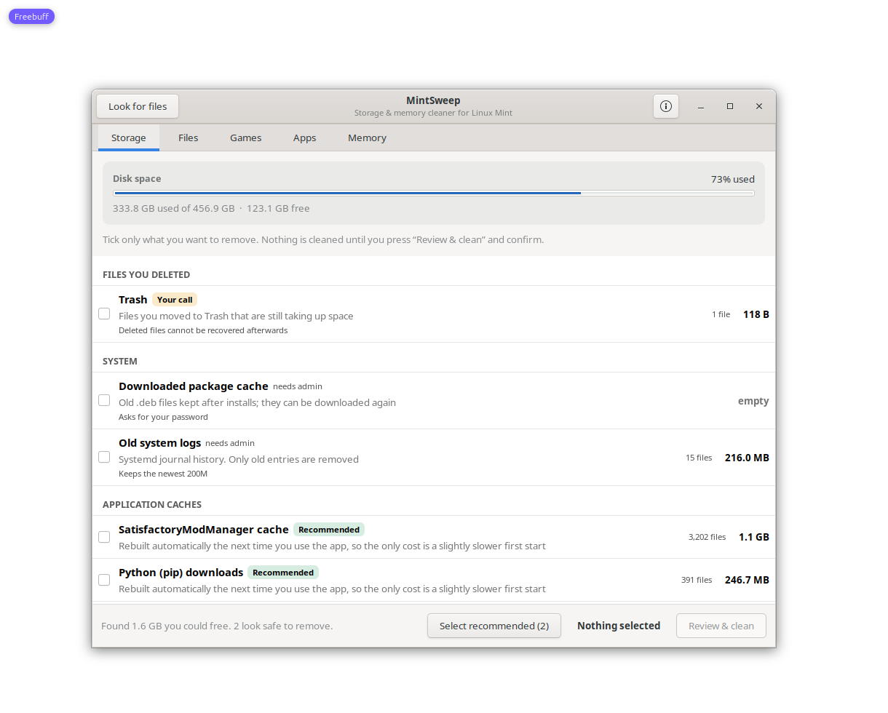
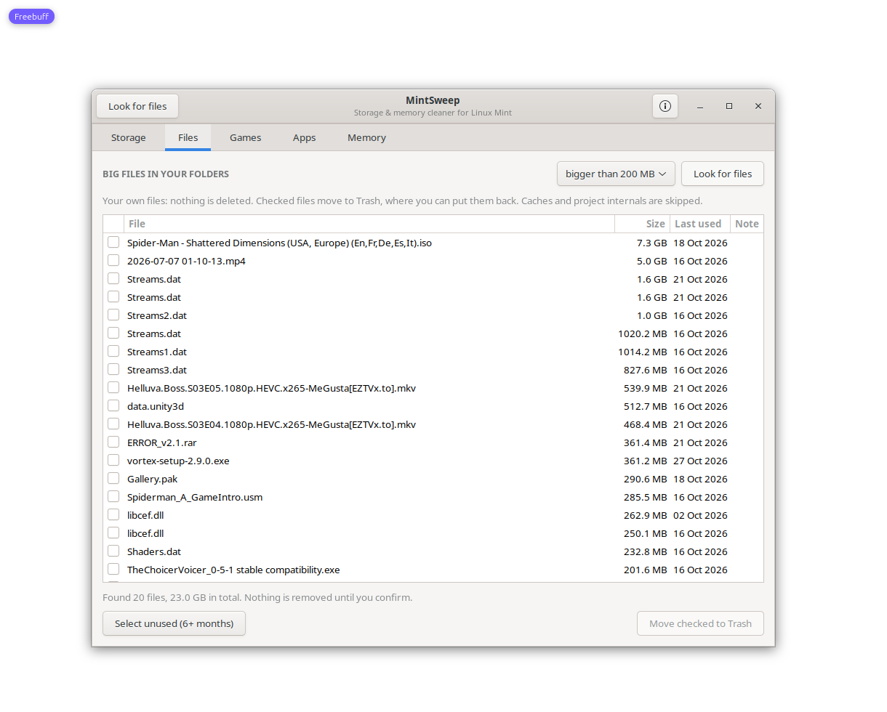
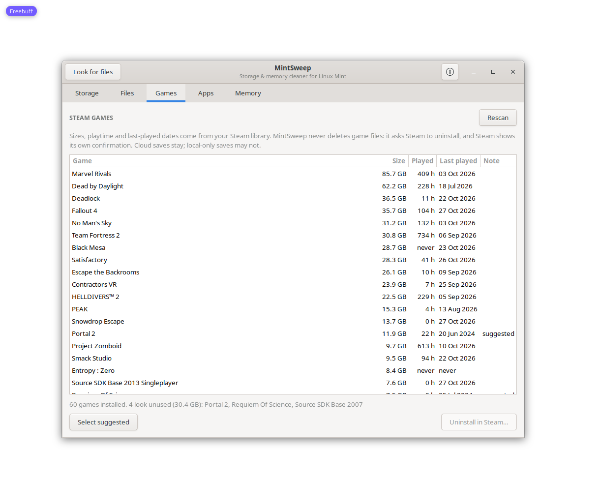

# MintSweep

A simple cleaner for Linux Mint. It shows you what is taking up space and only
removes what you tick and confirm.



## What it does

* **Storage** – clears app caches, the apt download cache, old system logs and
  Trash.
* **Files** – finds large files in Desktop, Documents, Downloads, Videos,
  Pictures and Music, and shows when you last used each one. Checked files go
  to Trash, so you can put them back.
* **Games** – lists your Steam games with size and playtime, and points out the
  big ones you have not played in months.
* **Apps** – shows installed Flatpak and system apps, and which ones have not
  been opened in a long time.
* **Memory** – shows RAM and swap, your biggest apps, and whether a restart
  would actually help.

## Nothing happens by itself

* Everything starts unticked. There is no automatic cleaning, no scheduled
  scan and no background service. Scanning only reads file sizes.
* Your files are never deleted. The Files tab moves them to Trash.
* Games are uninstalled by Steam itself, not by MintSweep.
* System packages are only listed; removing them stays in Software Manager.
* Anything that needs administrator rights asks for your password first.
* Apps are only closed when you pick one and confirm.

## Install

Download or clone this folder, then:

```bash
./install.sh
```

That adds a menu entry and a `mintsweep` command in `~/.local/bin` for your
user only; nothing is installed system-wide.

`./install.sh --uninstall` removes them again.

Requires Python 3 with GTK 3 (`python3-gi`, `gir1.2-gtk-3.0`), which Linux Mint
already ships. Tested on Linux Mint 22.3.

## Or just run it

```bash
./bin/mintsweep
```

## Command line

```bash
mintsweep scan     # what can be cleaned
mintsweep files    # large files in your folders
mintsweep games    # Steam games and playtime
mintsweep apps     # installed apps and unused ones
mintsweep ram      # memory and biggest processes
```

These commands only list things. Cleaning and closing happens in the app.

## Screenshots





## Tests

```bash
python3 tests/test_core.py
```

They run against a temporary home folder, so nothing real is touched.

## License

MIT. See [LICENSE](LICENSE).
